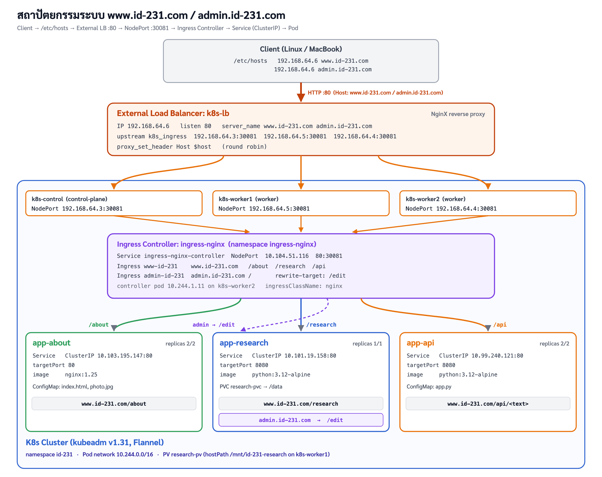

# CT655 – K8s service ด้วย Ingress: www.id-231.com

นายนิติภูมิ มอญดี รหัสนักศึกษา 68130231 (3 ตัวท้าย = 231)

| URL | แอป | การทำงาน |
|---|---|---|
| `www.id-231.com/about` | app-about | แสดงรูป ชื่อ และรหัสนักศึกษา |
| `www.id-231.com/research` | app-research | แสดงสรุปงานวิจัย |
| `www.id-231.com/api/<ข้อความ>` | app-api | แสดงข้อความตัวใหญ่กลางจอ |
| `admin.id-231.com` | app-research (`/edit`) | หน้าแก้ไขสรุปงานวิจัยแล้วบันทึกกลับ |



## โครงสร้างไฟล์

```
apps/
  app-about/      index.html, photo.jpg, default.conf (nginx)
  app-research/   app.py, research.txt (ข้อความเริ่มต้น)
  app-api/        app.py
k8s/
  00-namespace.yaml      namespace id-231
  10-app-about.yaml      Deployment + Service (ClusterIP)
  20-app-research.yaml   PV + PVC + Deployment + Service (ClusterIP)
  30-app-api.yaml        Deployment + Service (ClusterIP)
  40-ingress.yaml        Ingress www-id-231 และ admin-id-231
ingress-controller/deploy.yaml   ingress-nginx v1.12.1 (baremetal) กำหนด NodePort 30081/30443
external-lb/www-id-231.conf      config ของ NginX บนเครื่อง LB หน้า cluster
hosts/hosts                      บรรทัดที่เพิ่มใน /etc/hosts ของเครื่อง client
deploy.sh, cleanup.sh            สคริปต์ deploy และลบ
report/                          รายงาน (report.pdf), ผลการทดสอบ (test.pdf) และสคริปต์ที่ใช้สร้าง
outputs/                         output จริงของทุกคำสั่งที่ใช้ในรายงาน
```

โค้ดของแอปใส่เข้า Pod ผ่าน ConfigMap จึงใช้ image `nginx:1.25` และ `python:3.12-alpine` ได้เลย ไม่ต้อง build image

## ระบบที่ใช้ทดสอบ

- K8s cluster จาก kubeadm v1.31 จำนวน 3 node: k8s-control `192.168.64.3`, k8s-worker1 `192.168.64.5`, k8s-worker2 `192.168.64.4`
- External LB (NginX): k8s-lb `192.168.64.6`
- PV ของ app-research เป็น hostPath `/mnt/id-231-research` บน `k8s-worker1` (ถ้าชื่อ node ต่างกันให้แก้ใน `k8s/20-app-research.yaml`)

## ขั้นตอน deploy

1. บนเครื่อง control-plane

```bash
git clone https://github.com/nitipoommorndee-wq/ct655-k8s-ingress-id231.git
cd ct655-k8s-ingress-id231
./deploy.sh
```

`deploy.sh` ทำตามลำดับนี้

```bash
kubectl apply -f ingress-controller/deploy.yaml
kubectl -n ingress-nginx rollout status deployment/ingress-nginx-controller --timeout=300s
kubectl apply -f k8s/00-namespace.yaml
kubectl -n id-231 create configmap app-about-web --from-file=apps/app-about/index.html --from-file=apps/app-about/photo.jpg
kubectl -n id-231 create configmap app-about-conf --from-file=apps/app-about/default.conf
kubectl -n id-231 create configmap app-research-code --from-file=apps/app-research/app.py --from-file=apps/app-research/research.txt
kubectl -n id-231 create configmap app-api-code --from-file=apps/app-api/app.py
kubectl apply -f k8s/10-app-about.yaml
kubectl apply -f k8s/20-app-research.yaml
kubectl apply -f k8s/30-app-api.yaml
kubectl apply -f k8s/40-ingress.yaml
```

2. บนเครื่อง LB (แก้ IP ของ node ใน upstream ให้ตรงกับ cluster)

```bash
sudo cp external-lb/www-id-231.conf /etc/nginx/conf.d/
sudo nginx -t && sudo systemctl reload nginx
```

3. บนเครื่อง client เพิ่มใน `/etc/hosts` (IP ของ LB)

```
192.168.64.6 www.id-231.com
192.168.64.6 admin.id-231.com
```

## ตรวจสอบและทดสอบ

```bash
kubectl -n id-231 get deploy,pod,svc,ingress -o wide
kubectl -n id-231 describe ingress www-id-231
kubectl -n id-231 describe ingress admin-id-231

curl -i http://www.id-231.com/about
curl -i http://www.id-231.com/research
curl -i http://www.id-231.com/api/Hello-K8s
curl -i http://admin.id-231.com/
```

ลบทั้งหมด: `./cleanup.sh`
